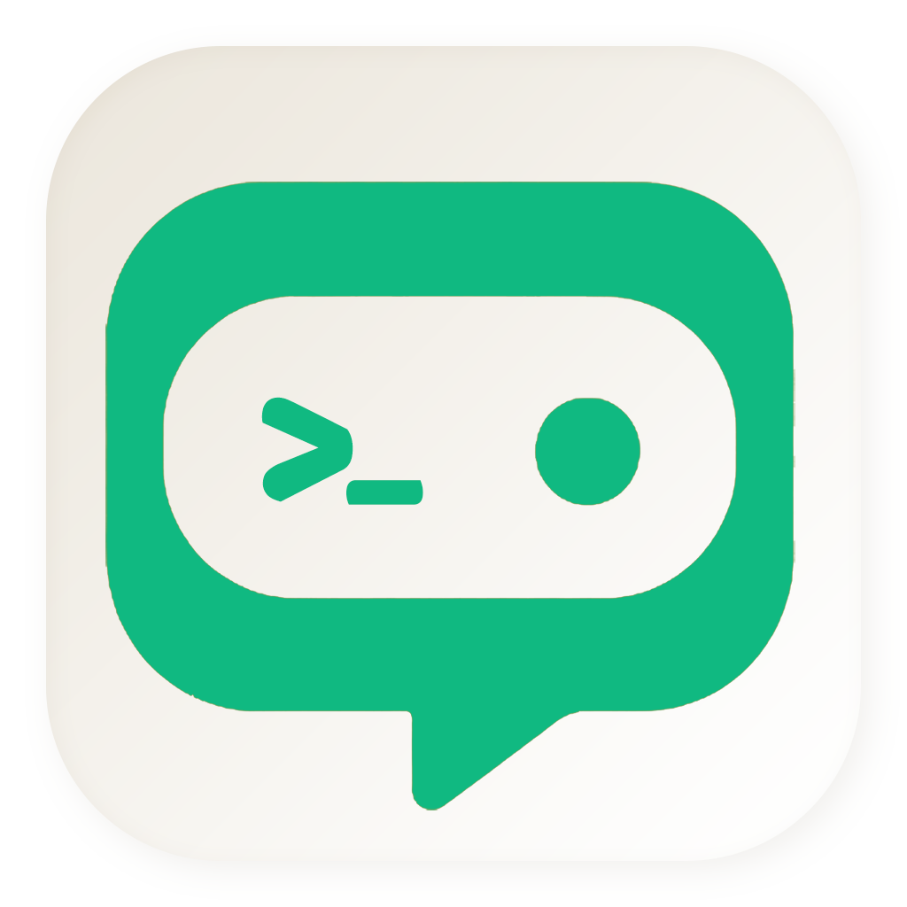
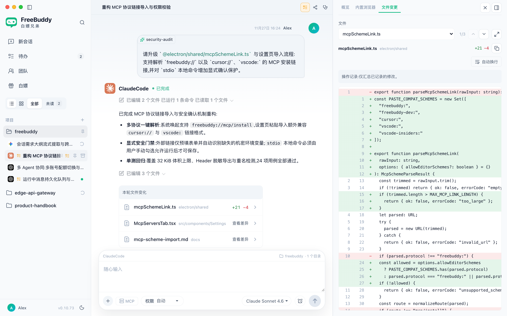
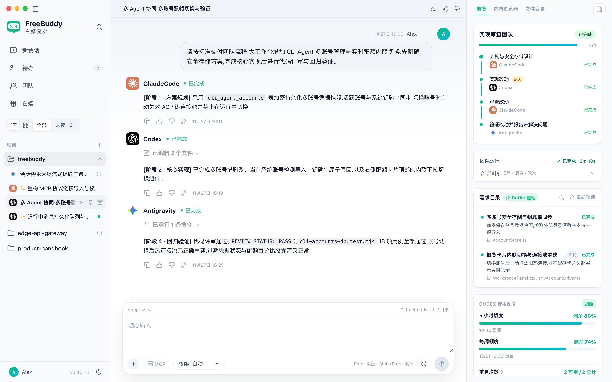
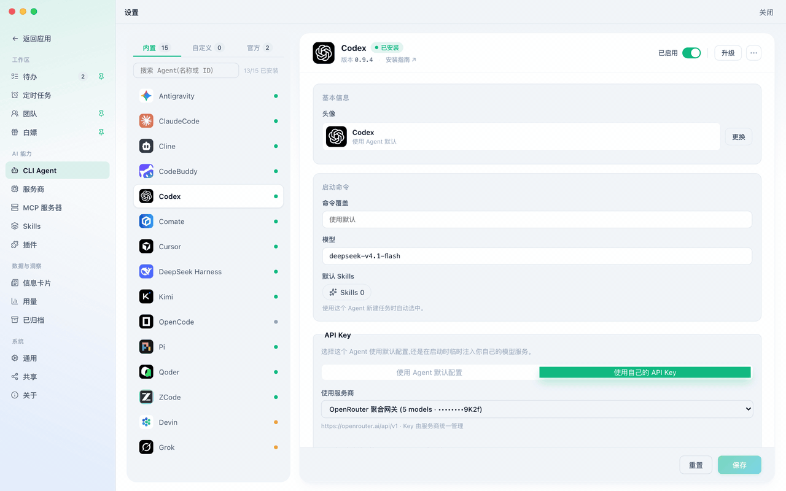
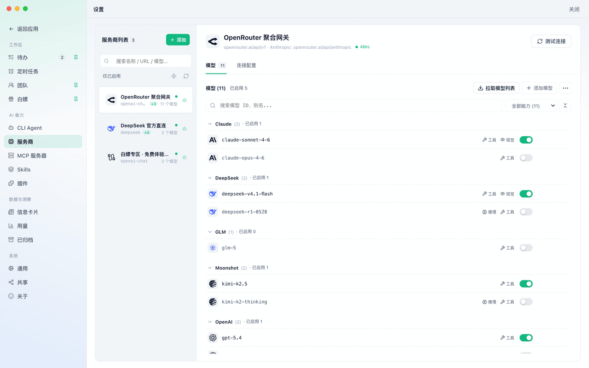
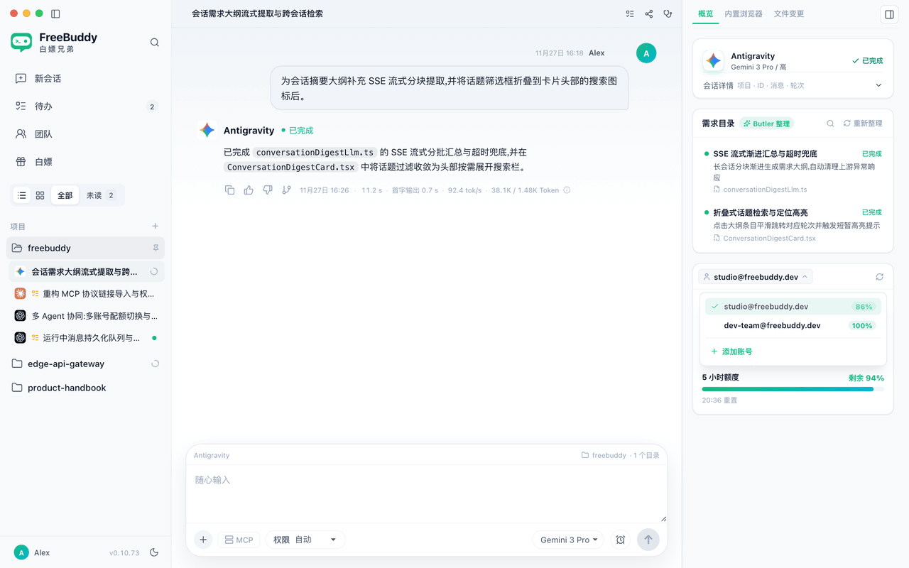

# FreeBuddy

<p align="center">
  
</p>

<p align="center">
  <a href="README.md">English</a> | <a href="README.zh-CN.md">简体中文</a>
</p>

**A desktop Agent Workbench: connect mainstream agents, orchestrate tasks and context, and review deliverables in one place.** ⚡

Bring Codex, ClaudeCode, Cursor, Antigravity, DeepSeek, Kimi, and 15 built-in ACP agents into a single desktop workbench. Across software engineering, research, and document workflows, FreeBuddy unifies cross-project task and todo tracking, conversation context handoff, multi-agent team orchestration, MCP and skill extensions, and integrated Diff, browser, and document review surfaces.

Two core ways to work:

### Single-Agent Sessions & Cross-Agent Handoff (Normal Mode)

Pair each conversation with a workspace folder and the right agent while tracking parallel work in the Task Panel. Queue follow-up messages mid-run, schedule delayed continuations, reference prior conversations, and hand off full context to another agent whenever needed.



### Multi-Agent Collaboration (Team Execution Mode)

Coordinate planning, implementation, review, and verification with structured workflow templates, or let a lead agent dynamically delegate subtasks across its team roster.



### [⬇️ Download FreeBuddy](https://github.com/maojindao55/freebuddy/releases/latest)

---

## Quick Start

1. [Download and launch FreeBuddy](https://github.com/maojindao55/freebuddy/releases/latest). Let the built-in **GuideBuddy** onboarding assistant detect your environment and install agents (with optional trial credits to start immediately), or configure runtimes manually under **Settings → CLI Agents** and manage API channels centrally in **Settings → Providers** (or import free endpoints from **Free tier**).
2. Create a conversation, pick a project directory and agent, and send your task. In the composer, type `@` to mention files or folders, `/` to attach skills, toggle **MCP Servers** per conversation, or drag existing conversations from the sidebar as context references.
3. When running multiple tasks in parallel, switch to the **Task Panel** or **Todos** board to filter active, unread, or pending-approval runs across projects. For multi-agent division of labor, switch to **Team Execution Mode** and customize roles and policies under **Teams** (or **Settings → Teams**).
4. To switch agents mid-task, open **Share or hand off this conversation → Hand off to an agent** at the top of the chat, preview the generated handoff brief, and continue seamlessly in a new session—or **Fork** a new branch from any message in history.

---

## Workbench Capabilities

| Capability | Description | Demo |
|---------|-------------|------|
| **Unified Agent Hub & Onboarding** | Built-in ACP integrations for 15 agents (including bundled `Pi` and the **GuideBuddy** setup assistant) with runtime detection, one-click installation, and version upgrade verification |  |
| **Task Panel & Todos Center** | Monitor cross-project run status, live tool activity, failures, and pending approvals; filter, search, expand fullscreen, and track flagged **Todos** | — |
| **Context Flow & Session Control** | **Cross-Agent Handoff**, async **Conversation Digest & cross-session topic search**, drag-and-drop **conversation references**, message-level **Fork**, live **Message Queue**, and unified **Scheduled Tasks / delayed send** | — |
| **Multi-Agent Team Orchestration** | Run structured **Workflow Teams** (with review-and-fix loops and approval gates) or **Delegation Teams** (autonomous subtask dispatch with role write/timeout controls) | — |
| **Unified Providers & BYOK** | Centrally manage encrypted API keys, health checks, and enabled model lists under **Providers**; link once across Codex (with built-in Responses ↔ Chat protocol bridge), ClaudeCode, DeepSeek, and Pi, or one-click import from **Free tier** |  |
| **Multi-Account & Usage Analytics** | View live rate-limit reset cards and switch saved accounts for Codex and Antigravity; inspect per-turn Token/latency metrics and global **Usage** analytics |  |
| **MCP Servers & Skills Ecosystem** | Connect local `stdio` and remote `HTTP` / `SSE` MCP servers (with browser OAuth and `freebuddy://` one-click link import), attach `/` skills per turn, and browse the Skill Market | — |
| **Integrated Review & Delivery Surfaces** | Built-in per-turn **File Changes & line-by-line Diff viewer**, split-pane **Browser preview**, **DocStudio** document workspace (Office & Markdown preview + AI copilot), and LAN **Shared WebUI** | — |

### 🎬 Multi-Agent Team Orchestration

- **Workflow Teams:** Execute configured planning, implementation, review, and verification stages. Built-in delivery workflows automatically loop back to implementation on review or verification feedback, with configurable approval gates and iteration limits.
- **Delegation Teams:** An entry agent breaks down complex tasks and dispatches subtasks to specialized roles in its roster, resuming once structured verdicts return. Configure per-role write permissions, pre-write approvals, delegation depth, and timeouts.

For example, pair Codex for implementation, ClaudeCode for code review, and Kimi or Antigravity for verification—dependent steps run sequentially while independent steps can execute in parallel according to runtime policy.

https://github.com/user-attachments/assets/9665bf24-9150-4ffa-b571-10eece2d2062

### 🔌 MCP Servers & Skills

- **Third-Party MCP Integration:** Register local `stdio` commands (with `${cwd}` workspace placeholders) or remote `HTTP` / `SSE` endpoints under **Settings → MCP Servers**, and enable them per conversation from the composer.
- **Browser OAuth for Remote MCP:** Authenticate against PKCE-enabled remote HTTP/SSE MCP servers through your system browser with OS-encrypted credential storage; see [MCP Browser OAuth](docs/mcp-oauth.md).
- **One-Click Link Import:** Launch and prefill MCP server configurations via `freebuddy://mcp/install` links, or paste `cursor://` and `vscode:` install links directly in Settings (always reviewed and confirmed by the user before saving or running); see the [MCP Scheme Integration Guide](docs/mcp-scheme-import.md).
- **Skills Workflow:** Type `/` in the composer to search and attach skills to individual turns, manage local skill folders, or install extensions from the Skill Market.

### 🖥️ Integrated Workspaces & Shared Access

- **Diff Review & Git Helpers:** Every turn summarizes modified files in an interactive card; click to inspect line-by-line diffs with syntax context, hunk folding, and one-click copy, plus one-click fast-forward pull on the current branch.
- **Split-Pane Browser & DocStudio:** Preview local web servers, HTML, or Markdown side-by-side in the built-in browser, or open **DocStudio** to preview and co-edit Office / Markdown documents with an AI copilot. Supports **"Open with FreeBuddy"** directly from macOS Finder and the top-level Windows 11 Explorer context menu.
- **LAN Shared Access (WebUI):** Enable **Settings → Shared** to host FreeBuddy for teammates over your local network. Each browser user gets isolated conversations, scheduled tasks, and a private managed workspace clone, with optional OS-level process sandboxing (macOS Seatbelt / Linux bubblewrap / Windows `srt-win`); see [Shared Access & Isolation](docs/remote-access.md).

<details>
<summary>☕ Wait-Time Extras (FeedRSS Card & Code Whip)</summary>

- **FeedRSS Card:** Catch up on subscribed tech and news feeds right inside the workbench while long agent runs are in progress.

https://github.com/user-attachments/assets/380965e3-d4eb-4ad1-bb0d-ded33c5272e9

- **Code Whip:** Click a running agent's avatar to trigger the Code Whip easter-egg animation and unwind while you wait.

https://github.com/user-attachments/assets/8bab605f-6f1b-4e53-a520-c3f5a6645ace

</details>

---

## Supported Agents

FreeBuddy connects to 15 agents out of the box over ACP (Agent Client Protocol). Some tools use a dedicated ACP adapter package; available models, authentication methods, and tool capabilities depend on each agent and adapter.

<p>
  <a href="https://github.com/agentclientprotocol/codex-acp"><kbd> Codex</kbd></a> &nbsp;
  <a href="https://github.com/agentclientprotocol/claude-agent-acp"><kbd> ClaudeCode</kbd></a> &nbsp;
  <a href="https://opencode.ai/docs"><kbd> OpenCode</kbd></a> &nbsp;
  <a href="https://docs.cursor.com/en/cli/overview"><kbd> Cursor</kbd></a> &nbsp;
  <a href="https://code.kimi.com"><kbd> Kimi</kbd></a> &nbsp;
  <a href="https://docs.qoder.com/en/cli/acp"><kbd> Qoder</kbd></a> &nbsp;
  <a href="https://www.npmjs.com/package/comate-acp"><kbd> Comate</kbd></a> &nbsp;
  <a href="https://www.codebuddy.cn/docs/cli/acp"><kbd> CodeBuddy</kbd></a> &nbsp;
  <a href="https://github.com/deepseek-ai/deepseek-harness"><kbd> DeepSeek</kbd></a> &nbsp;
  <a href="https://docs.x.ai/build/cli/reference"><kbd> Grok</kbd></a> &nbsp;
  <a href="https://antigravity.google/docs/ide/extensions/acp/"><kbd> Antigravity</kbd></a> &nbsp;
  <a href="https://github.com/william0wang/zcode-acp"><kbd> ZCode</kbd></a> &nbsp;
  <a href="https://docs.cline.bot/usage/acp"><kbd> Cline</kbd></a> &nbsp;
  <a href="https://docs.devin.ai/cli"><kbd> Devin</kbd></a> &nbsp;
  <a href="https://github.com/svkozak/pi-acp"><kbd> Pi</kbd></a>
</p>

<details>
<summary>Commands and Installation</summary>

Use **Settings → CLI Agents → Install** (or **Ask GuideBuddy to Install**) for platform-appropriate setup. Shell commands below target macOS / Linux; Windows users should prefer the in-app installer.

| Agent | Default Command | Installation |
|--------|---------|--------|
| **Codex** | `codex-acp` | `npm install -g --force @agentclientprotocol/codex-acp` |
| **ClaudeCode** | `claude-agent-acp` | `npm install -g --include=optional @agentclientprotocol/claude-agent-acp` |
| **OpenCode** | `opencode` | `npm install -g opencode-ai` |
| **Cursor** | `cursor-agent` | `curl https://cursor.com/install -fsS \| bash` |
| **Kimi** | `kimi` | `curl -fsSL https://code.kimi.com/kimi-code/install.sh \| bash` |
| **Qoder** | `qodercli` | `curl -fsSL https://qoder.com/install \| bash` |
| **Comate** | `comate-acp` | `npm install -g comate-acp @comate/comatecli` |
| **CodeBuddy** | `codebuddy` | `npm install -g @tencent-ai/codebuddy-code` |
| **Grok** | `grok` | `curl -fsSL https://x.ai/cli/install.sh \| bash` (or install in Settings) |
| **Antigravity** | `agy` (runs `agy acp`) | `curl -fsSL https://antigravity.google/cli/install.sh \| bash` (1.5.9+; see [native ACP migration notes](docs/antigravity-native-acp.md)) |
| **DeepSeek Harness** | `deepseek-harness-acp` | Settings → CLI Agents → **Install** (or `npm install -g deepseek-harness-acp`) |
| **ZCode** | `zcode-acp-server` | `npm install -g zcode-acp-server` |
| **Cline** | `cline` | `npm install -g cline` |
| **Devin** | `devin` | `curl -fsSL https://cli.devin.ai/install.sh \| bash` (or install in Settings) |
| **Pi** | `pi-acp` | Bundled with FreeBuddy; no separate install needed. Also powers the built-in **GuideBuddy** onboarding assistant |

Link DeepSeek Harness to a **Providers** BYOK entry, configure an API key directly in its agent settings, or set `DEEPSEEK_API_KEY`; see the [DeepSeek ACP integration notes](docs/dsh-standalone-local-testing.md) for local testing details.

</details>

Open **Settings → CLI Agents** to:

- ✅ Detect installed runtime versions, check for updates, and verify upgrades
- 📥 Run one-click recommended installs or ask **GuideBuddy** to set up missing agents
- 🔗 Link **Providers** BYOK channels and enabled custom model catalogs
- 👤 Manage multiple signed-in accounts and live quota snapshots (Codex, Antigravity, etc.)
- ⚙️ Customize binary paths, default models, environment variables, extra arguments, and agent avatars

---

## Installation

### Desktop (macOS / Windows / Linux)

**Quick Download:** [FreeBuddy Releases](https://github.com/maojindao55/freebuddy/releases/latest)

| Platform | Download | Package Manager / Notes |
|----------|---------|----------------|
| **macOS (Apple Silicon)** | `.dmg` / `.zip` | `brew install --cask maojindao55/freebuddy/freebuddy` |
| **macOS (Intel)** | `.dmg` / `.zip` | - |
| **Windows (x64)** | `.exe` installer | Ships with a managed Node runtime—no system Node required |
| **Ubuntu / Debian (x64)** | `.deb` | `sudo apt install ./FreeBuddy_Ubuntu_x64-<version>.deb` |
| **Linux (x64)** | `.AppImage` | `chmod +x FreeBuddy_Linux_x64-<version>.AppImage` |

The AppImage uses a static runtime and runs on current Ubuntu releases without installing FUSE 2.

### Build from Source

Prerequisites: Node.js 22.22+, npm 9+.

```bash
# Clone the repository
git clone https://github.com/maojindao55/freebuddy.git
cd freebuddy

# Install dependencies
npm install

# Run in development mode
npm run dev

# Typecheck and run tests
npm run typecheck && npm test

# Production build and launch
npm run start
```

Before pushing a branch or creating a pull request, verify both the stored
GitHub CLI login and real API access:

```bash
npm run github:preflight
```

The check never prints token values or creates a new OAuth token. If it fails,
follow the displayed recovery instructions and run the check again. Inside a
Codex sandbox, verify once with system permissions before starting a new login,
because the sandbox may be unable to access the macOS keychain or network.

> **Note:** `npm run start` builds before launching. `postinstall` patches and runs `electron-rebuild` for `better-sqlite3` and `node-pty` to ensure native bindings match your Electron version.

---

## Star History

<a href="https://www.star-history.com/?repos=maojindao55%2Ffreebuddy&type=date&legend=top-left">
 <picture>
   <source media="(prefers-color-scheme: dark)" srcset="https://api.star-history.com/chart?repos=maojindao55/freebuddy&type=date&theme=dark&legend=top-left&sealed_token=_vBp2Ba6BbtTnwG5RXtVyOwRKsvfS1B4qKjYHT1ZQBN7CXun63Yd81CGPV3LIDB3BafxDPgNcLDDdd-tinwwl6cAZp_S3ZYXHT91BJdw2jckP_G3Z0B1ig" />
   <source media="(prefers-color-scheme: light)" srcset="https://api.star-history.com/chart?repos=maojindao55/freebuddy&type=date&legend=top-left&sealed_token=_vBp2Ba6BbtTnwG5RXtVyOwRKsvfS1B4qKjYHT1ZQBN7CXun63Yd81CGPV3LIDB3BafxDPgNcLDDdd-tinwwl6cAZp_S3ZYXHT91BJdw2jckP_G3Z0B1ig" />
   
 </picture>
 </a>

---

## Community & Support

- 🐧 **QQ Group:** [Click to join](https://qm.qq.com/q/Lgu4uyIWCC)

---

## Contributing

Report bugs or suggest improvements through [Issues](https://github.com/maojindao55/freebuddy/issues), or contribute a pull request. Run `npm run github:preflight` above before pushing a branch or creating a pull request.

### Contributors

<a href="https://github.com/maojindao55/freebuddy/graphs/contributors">
  
</a>

---

## License

FreeBuddy is licensed under the MIT License.

---

<p align="center">
  Made with ❤️ by <a href="https://github.com/maojindao55">maojindao55</a>
</p>
