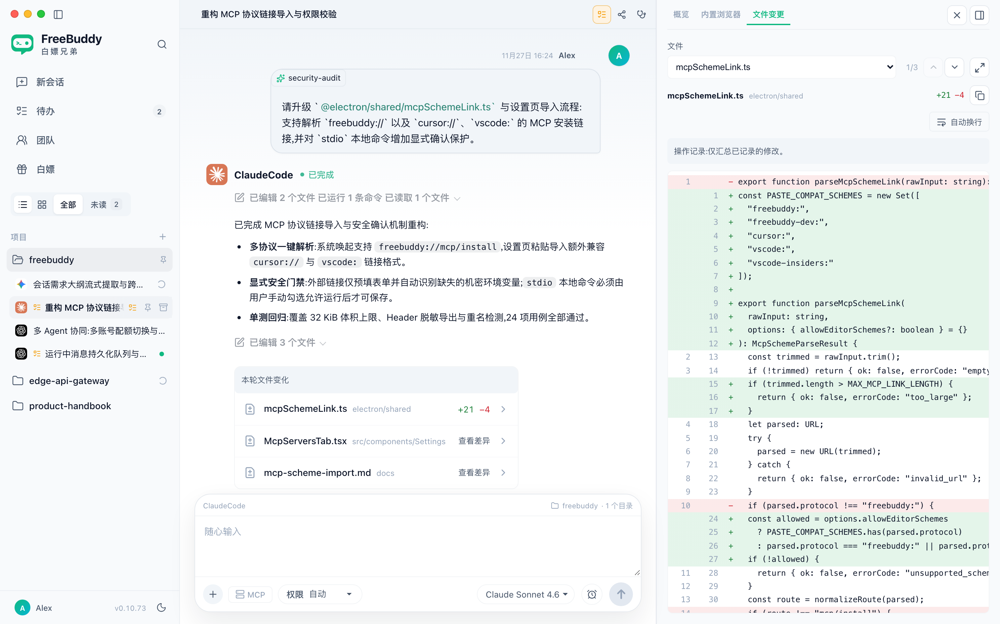
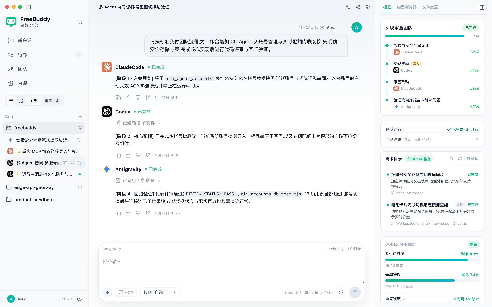
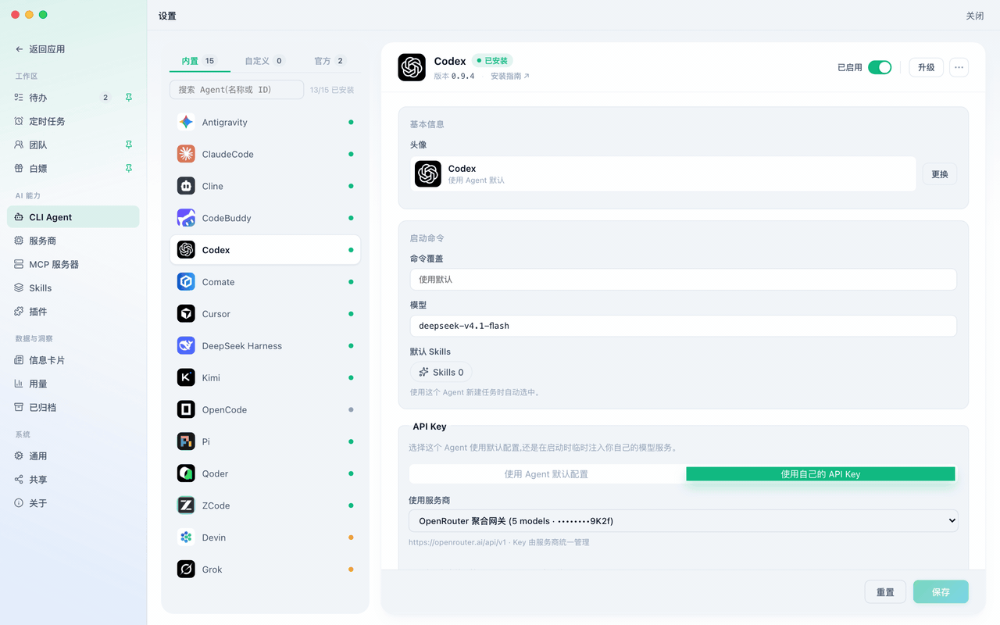
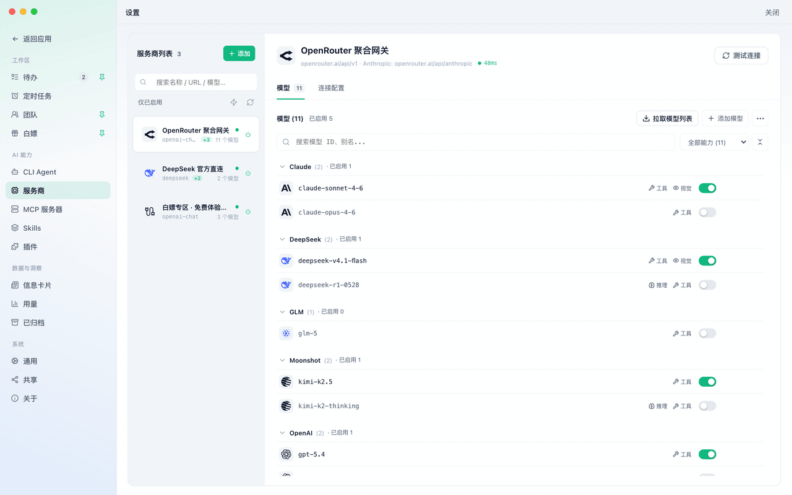
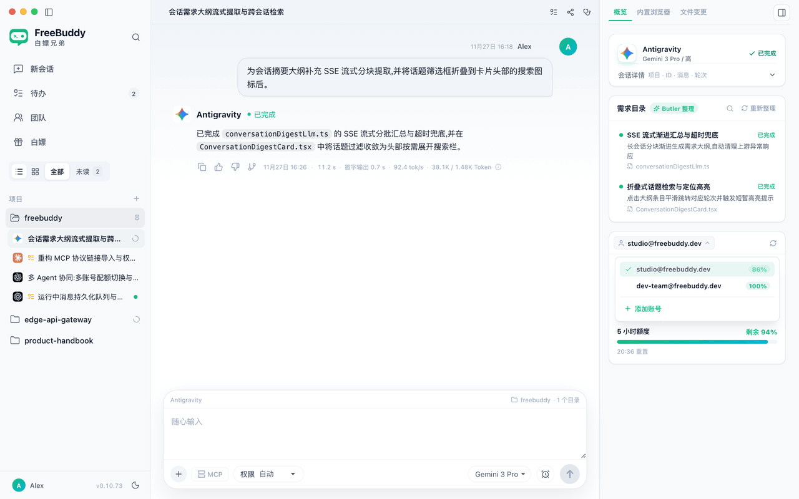

# FreeBuddy

<p align="center">
  
</p>

<p align="center">
  <a href="README.md">English</a> | <a href="README.zh-CN.md">简体中文</a>
</p>

**一站式桌面 Agent 工作台：统一接入主流 Agent，统筹任务与上下文，协同编排并内嵌审阅交付。** ⚡

把 Codex、ClaudeCode、Cursor、Antigravity、DeepSeek、Kimi 等 15 款 Agent 汇聚在同一个桌面工作台中。围绕编码实现、技术调研、文档协作等日常工作，打通跨项目任务与待办追踪、会话上下文流转、多 Agent 团队编排、MCP 与技能扩展，以及代码 Diff、内置浏览器、文档工作台等一体化审阅体验。

支持两种核心协作范式：

### 单 Agent 会话与跨 Agent 接力（普通模式）

为每个会话绑定工作目录与最擅长的 Agent，在任务面板中并行跟进多个项目进展；支持运行中排队追加指令、定时续跑、跨会话引用背景，随时将会话上下文无损转接给其他 Agent 接力推进。



### 多 Agent 团队编排（团队执行模式）

按工作流模板编排规划、实现、评审与验证闭环，或由入口 Agent 根据花名册角色能力自主拆解并委派子任务。



### [⬇️ 下载 FreeBuddy](https://github.com/maojindao55/freebuddy/releases/latest)

---

## 快速开始

1. [下载安装 FreeBuddy](https://github.com/maojindao55/freebuddy/releases/latest)。首次启动可跟随内置引导助手 **GuideBuddy** 自动检测环境、一键安装常用 Agent（支持直接领取体验额度上手）；也可前往 **设置 → CLI Agent** 手动安装登录，或在 **设置 → 服务商**（及侧边栏 **白嫖** 专区）统一配置第三方模型渠道。
2. 新建会话，选择项目目录与 Agent 发送任务。输入框支持 `@` 引用工作区文件或目录、`/` 搜索调用本轮技能、按需勾选 **MCP 服务器**，也可直接从左侧列表拖入其他会话作为参考上下文。
3. 多任务并行推进时，可切到 **任务面板** 或 **待办（Todos）** 跨项目筛选运行中、未读或待确认事项；需要多角色协作时，切至 **团队执行模式** 并在侧边栏 **团队**（或 **设置 → 团队**）配置角色、Agent 与执行策略。
4. 需要换用其他 Agent 接手时，打开会话顶部的 **分享或转接 → 交给其他 Agent 接管**，预览自动提炼的交接摘要后即可在新会话无缝续做；也可以从任意历史消息一键 **分叉（Fork）** 出新会话探索不同方案。

---

## 工作台核心能力

| 模块 | 能力说明 | 演示 |
|---------|-------------|-------------|
| **统一 Agent 接入与引导** | 基于 ACP 协议内置集成 15 款主流 Agent（含随包内置的 `Pi` 运行时与新手向导 **GuideBuddy**），支持自动探测、一键安装与版本升级验证 |  |
| **任务面板与待办中枢** | 集中查看跨项目会话状态、近期工具活动、异常与待审批请求；支持全屏看板、多维筛选与 **待办（Todos）** 聚合追踪 | — |
| **上下文流转与会话治理** | 支持 **跨 Agent 交接（Handoff）**、异步生成 **会话需求大纲（Digest）与跨会话主题检索**、拖拽 **跨会话引用**、消息级 **分叉（Fork）**、运行中 **消息队列** 与 **持久化定时发送 / 定时任务** | — |
| **多 Agent 团队编排** | 同时支持结构化 **工作流团队**（含评审修复循环与审批门禁）与 **自组织委派团队**（入口 Agent 动态派发子任务、权限与超时治理） | — |
| **统一服务商中心与 BYOK** | 在 **服务商（Providers）** 集中加密管理 API Key、连通性检测与模型开关，一键关联 Codex（内置 Responses ↔ Chat 协议桥接）、ClaudeCode、DeepSeek、Pi 等 Agent；支持从 **白嫖** 专区一键导入免费渠道 |  |
| **多账号管理与用量洞察** | 支持 Codex、Antigravity 限额重置卡片与多账号一键切换；在消息行展示单轮 Token / 耗时指标，并提供全局 **用量（Usage）** 统计页 |  |
| **MCP 服务器与技能生态** | 支持本地 `stdio` 与远程 `HTTP` / `SSE` MCP 服务器（含浏览器 OAuth 授权与 `freebuddy://` 链接一键导入）、`/` 技能调用及技能市场 | — |
| **内嵌审阅与交付工作区** | 内置本轮 **文件变更卡片与逐行 Diff 面板**、**分栏浏览器预览**、**文档工作台（DocStudio / Office & Markdown 预览协作）**，并支持局域网多人 **共享 WebUI** | — |

### 🎬 多 Agent 团队编排

- **工作流团队（Workflow Teams）**：按阶段执行规划、实现、评审和验证。内置交付模板可根据评审或验证反馈自动打回修复，并支持设置人工审批节点与最大循环轮次。
- **自组织委派团队（Delegation Teams）**：入口 Agent 根据任务复杂度，自主将子任务委派给花名册中的专职角色，待子任务回传结构化结果后继续推进；可细粒度控制角色写权限、写前审批、委派深度与超时时间。

例如由 Codex 负责实现、ClaudeCode 负责代码评审、Kimi 或 Antigravity 负责回归验证——有依赖的步骤按序流转，独立步骤可按运行策略并行推进。

https://github.com/user-attachments/assets/9665bf24-9150-4ffa-b571-10eece2d2062

### 🔌 MCP 服务器与 Skills 扩展

- **第三方 MCP 接入**：在 **设置 → MCP 服务器** 中添加本地 `stdio` 命令（支持 `${cwd}` 工作区占位符）或远程 `HTTP` / `SSE` 服务，并在对话输入框按会话按需启用。
- **远程浏览器 OAuth 授权**：连接支持 PKCE 的远程 MCP 服务时，可直接通过系统浏览器完成 OAuth 登录与令牌安全托管，详见 [MCP 浏览器授权说明](docs/mcp-oauth.md)。
- **一键链接导入**：支持点击 `freebuddy://mcp/install` 协议链接唤起桌面端预填配置，同时在设置页兼容直接粘贴 `cursor://` 与 `vscode:` 安装链接（保存前均需人工确认，绝不静默执行），接入规范详见 [MCP Scheme 链接接入指南](docs/mcp-scheme-import.md)。
- **技能（Skills）管理**：支持在输入框通过 `/` 快速检索并附加本条消息使用的技能，支持本地技能管理与技能市场安装。

### 🖥️ 内嵌审阅视图与局域网共享

- **代码审阅与 Git 辅助**：每轮对话结束后自动汇总变更文件卡片，点击即可在右侧打开逐行 Diff 面板（支持行号、增删高亮、上下文折叠与复制），并支持当前分支一键 Fast-forward Pull。
- **分栏浏览器与文档工作台（DocStudio）**：在同一窗口分栏打开内置浏览器实时预览前端页面或 Markdown 文件，或进入文档工作台预览编辑文档并与右侧 Copilot 协同创作；支持 macOS Finder 与 Windows 11 资源管理器一级右键菜单 **「使用 FreeBuddy 打开」**。
- **局域网多人共享（Shared WebUI）**：在 **设置 → 共享** 开启后，同局域网成员可直接通过浏览器使用主机配置好的 Agent。每位成员拥有独立的会话、定时任务与私有克隆工作区，并可按账号开启跨平台系统级进程沙箱隔离（macOS Seatbelt / Linux bubblewrap / Windows `srt-win`），详见 [局域网共享与隔离说明](docs/remote-access.md)。

<details>
<summary>☕ 等待间隙的小组件（FeedRSS 资讯卡片 & 码鞭解压彩蛋）</summary>

- **FeedRSS 资讯卡片**：等待 Agent 执行长任务时，可在工作台浏览订阅的技术与行业资讯流。

https://github.com/user-attachments/assets/380965e3-d4eb-4ad1-bb0d-ded33c5272e9

- **码鞭道具（Code Whip）**：点击正在运行中的 Agent 头像触发码鞭彩蛋动画，在等待间隙轻松解压。

https://github.com/user-attachments/assets/8bab605f-6f1b-4e53-a520-c3f5a6645ace

</details>

---

## 支持的 Agent

FreeBuddy 通过统一的 ACP（Agent Client Protocol）运行时连接下列 15 款 Agent。部分工具需安装对应的 ACP 适配器；模型列表、认证方式与工具能力取决于所选 Agent 及其适配器。

<p>
  <a href="https://github.com/agentclientprotocol/codex-acp"><kbd> Codex</kbd></a> &nbsp;
  <a href="https://github.com/agentclientprotocol/claude-agent-acp"><kbd> ClaudeCode</kbd></a> &nbsp;
  <a href="https://opencode.ai/docs"><kbd> OpenCode</kbd></a> &nbsp;
  <a href="https://docs.cursor.com/en/cli/overview"><kbd> Cursor</kbd></a> &nbsp;
  <a href="https://code.kimi.com"><kbd> Kimi</kbd></a> &nbsp;
  <a href="https://docs.qoder.com/en/cli/acp"><kbd> Qoder</kbd></a> &nbsp;
  <a href="https://www.npmjs.com/package/comate-acp"><kbd> Comate</kbd></a> &nbsp;
  <a href="https://www.codebuddy.cn/docs/cli/acp"><kbd> CodeBuddy</kbd></a> &nbsp;
  <a href="https://github.com/deepseek-ai/deepseek-harness"><kbd> DeepSeek</kbd></a> &nbsp;
  <a href="https://docs.x.ai/build/cli/reference"><kbd> Grok</kbd></a> &nbsp;
  <a href="https://antigravity.google/docs/ide/extensions/acp/"><kbd> Antigravity</kbd></a> &nbsp;
  <a href="https://github.com/william0wang/zcode-acp"><kbd> ZCode</kbd></a> &nbsp;
  <a href="https://docs.cline.bot/usage/acp"><kbd> Cline</kbd></a> &nbsp;
  <a href="https://docs.devin.ai/cli"><kbd> Devin</kbd></a> &nbsp;
  <a href="https://github.com/svkozak/pi-acp"><kbd> Pi</kbd></a>
</p>

<details>
<summary>运行命令与安装方式</summary>

推荐直接通过 **设置 → CLI Agent → 安装**（或点击 **让 GuideBuddy 安装**）使用适配当前平台的安装流程。下列终端命令适用于 macOS / Linux；Windows 用户建议使用应用内安装入口。

| Agent | 默认命令 | 安装方式 |
|--------|---------|--------|
| **Codex** | `codex-acp` | `npm install -g --force @agentclientprotocol/codex-acp` |
| **ClaudeCode** | `claude-agent-acp` | `npm install -g --include=optional @agentclientprotocol/claude-agent-acp` |
| **OpenCode** | `opencode` | `npm install -g opencode-ai` |
| **Cursor** | `cursor-agent` | `curl https://cursor.com/install -fsS \| bash` |
| **Kimi** | `kimi` | `curl -fsSL https://code.kimi.com/kimi-code/install.sh \| bash` |
| **Qoder** | `qodercli` | `curl -fsSL https://qoder.com/install \| bash` |
| **Comate（文心快码）** | `comate-acp` | `npm install -g comate-acp @comate/comatecli` |
| **CodeBuddy** | `codebuddy` | `npm install -g @tencent-ai/codebuddy-code` |
| **Grok** | `grok` | `curl -fsSL https://x.ai/cli/install.sh \| bash`（或设置页一键安装） |
| **Antigravity** | `agy`（运行 `agy acp`） | `curl -fsSL https://antigravity.google/cli/install.sh \| bash`（需 1.5.9+；迁移说明见 [原生 ACP 接入文档](docs/antigravity-native-acp.md)） |
| **DeepSeek Harness** | `deepseek-harness-acp` | 设置 → CLI Agent → **安装**（或 `npm install -g deepseek-harness-acp`） |
| **ZCode** | `zcode-acp-server` | `npm install -g zcode-acp-server` |
| **Cline** | `cline` | `npm install -g cline` |
| **Devin** | `devin` | `curl -fsSL https://cli.devin.ai/install.sh \| bash`（或设置页一键安装） |
| **Pi** | `pi-acp` | 随 FreeBuddy 内置，开箱即用；同时驱动官方引导助手 **GuideBuddy** |

DeepSeek Harness 可直接关联 **服务商** 中的 BYOK 渠道、在 Agent 页填写密钥，或配置 `DEEPSEEK_API_KEY` 环境变量；本地调试细节见 [DeepSeek ACP 集成说明](docs/dsh-standalone-local-testing.md)。

</details>

打开 **设置 → CLI Agent** 可以：

- ✅ 自动检测已安装的运行时版本、检查更新并验证升级结果
- 📥 一键执行平台推荐安装或呼叫 **GuideBuddy** 代装缺失组件
- 🔗 关联 **服务商（Providers）** 的第三方 BYOK 渠道与自定义模型列表
- 👤 管理多账号登录态与配额快照（支持 Codex、Antigravity 等）
- ⚙️ 自定义二进制路径、默认模型、环境变量、启动参数与专属头像

---

## 安装

### 桌面端（macOS / Windows / Linux）

**快速下载：** [FreeBuddy Releases](https://github.com/maojindao55/freebuddy/releases/latest)

| 平台 | 下载 | 包管理器 / 安装说明 |
|----------|---------|----------------|
| **macOS (Apple Silicon)** | `.dmg` / `.zip` | `brew install --cask maojindao55/freebuddy/freebuddy` |
| **macOS (Intel)** | `.dmg` / `.zip` | - |
| **Windows (x64)** | `.exe` 安装包 | 内置托管 Node 运行时，无需预先配置系统 Node |
| **Ubuntu / Debian (x64)** | `.deb` | `sudo apt install ./FreeBuddy_Ubuntu_x64-<版本>.deb` |
| **Linux (x64)** | `.AppImage` | `chmod +x FreeBuddy_Linux_x64-<版本>.AppImage` |

AppImage 采用静态运行时打包，在当前 Ubuntu 发行版上无需额外安装 FUSE 2 即可直接运行。

### 从源码构建

前置要求：Node.js 22.22+，npm 9+。

```bash
# 克隆仓库
git clone https://github.com/maojindao55/freebuddy.git
cd freebuddy

# 安装依赖
npm install

# 开发模式运行
npm run dev

# 类型检查与测试
npm run typecheck && npm test

# 生产构建并启动
npm run start
```

推送分支或创建 PR 前，请运行预检脚本同时验证 GitHub CLI 本地登录态与实际 API 访问权限：

```bash
npm run github:preflight
```

该检查不会输出任何 Token 值，也不会创建新的 OAuth Token。检查失败时请按终端提示修复后重试；若在 Codex 沙箱内失败，请先使用系统权限复查一次（沙箱可能无法访问 macOS 钥匙串或网络），避免重复触发浏览器登录。

> **注意：** `npm run start` 会先执行完整构建再启动应用。`postinstall` 会自动为 `better-sqlite3` 和 `node-pty` 执行补丁与 `electron-rebuild`，确保原生模块与当前 Electron 版本一致。

---

## Star History

<a href="https://www.star-history.com/?repos=maojindao55%2Ffreebuddy&type=date&legend=top-left">
 <picture>
   <source media="(prefers-color-scheme: dark)" srcset="https://api.star-history.com/chart?repos=maojindao55/freebuddy&type=date&theme=dark&legend=top-left&sealed_token=_vBp2Ba6BbtTnwG5RXtVyOwRKsvfS1B4qKjYHT1ZQBN7CXun63Yd81CGPV3LIDB3BafxDPgNcLDDdd-tinwwl6cAZp_S3ZYXHT91BJdw2jckP_G3Z0B1ig" />
   <source media="(prefers-color-scheme: light)" srcset="https://api.star-history.com/chart?repos=maojindao55/freebuddy&type=date&legend=top-left&sealed_token=_vBp2Ba6BbtTnwG5RXtVyOwRKsvfS1B4qKjYHT1ZQBN7CXun63Yd81CGPV3LIDB3BafxDPgNcLDDdd-tinwwl6cAZp_S3ZYXHT91BJdw2jckP_G3Z0B1ig" />
   
 </picture>
 </a>

---

## 社区与支持

- 🐧 **QQ群：** [点击链接加入群聊](https://qm.qq.com/q/Lgu4uyIWCC)

---

## 贡献

欢迎通过 [Issues](https://github.com/maojindao55/freebuddy/issues) 反馈问题或功能建议，也欢迎提交 Pull Request。推送分支或创建 PR 前请先通过上文说明的 `npm run github:preflight` 检查。

### 贡献者

<a href="https://github.com/maojindao55/freebuddy/graphs/contributors">
  
</a>

---

## 许可证

FreeBuddy 采用 MIT 许可证。

---

<p align="center">
  用 ❤️ 制作 by <a href="https://github.com/maojindao55">maojindao55</a>
</p>
